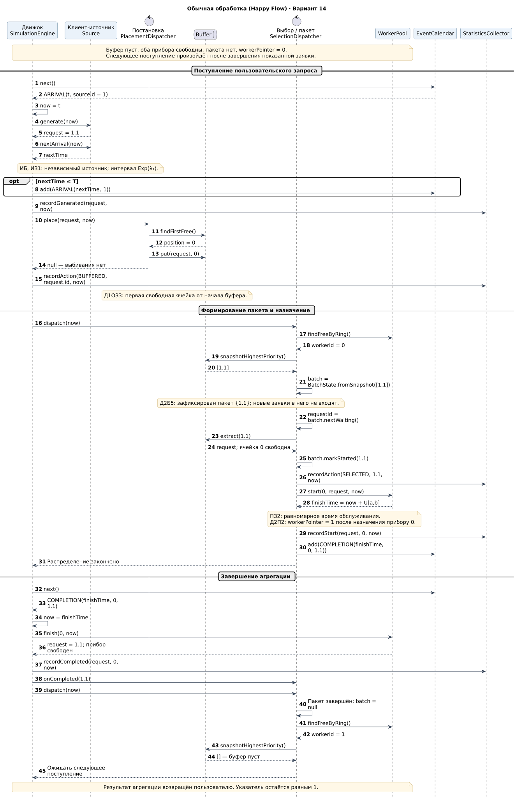
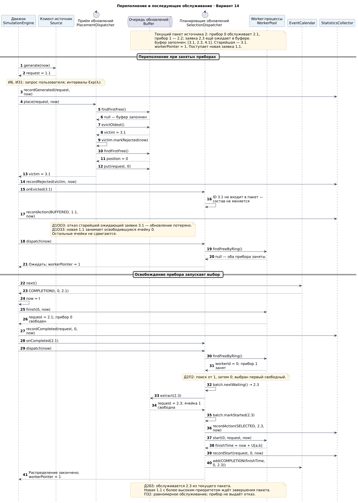
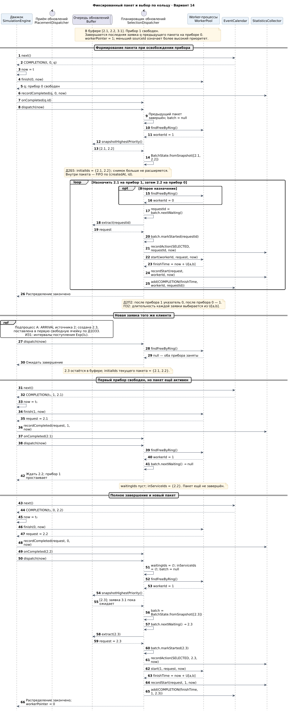
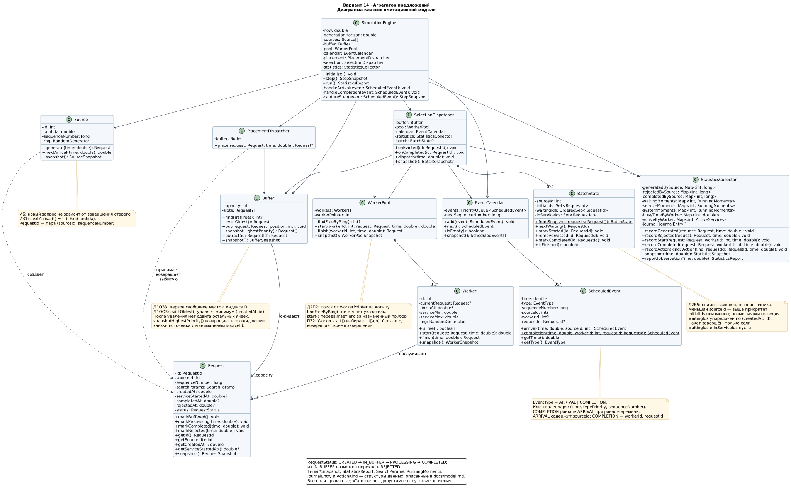

# Агрегатор предложений маркетплейсов — вариант 14

**Ивашин Даниил Владимирович**  
Группа **5130904/40102**

Пользователь ищет предложения, открывает каталог или меняет фильтры в веб-приложении либо Telegram-боте. Его действие создаёт запрос на сбор актуальных предложений, который попадает в очередь обновлений. Worker-процесс приводит данные предложения к общему формату и обновляет каталог.

## Элементы модели

| Элемент СМО | Бизнес-сущность |
|---|---|
| Источник | Пользовательский клиент агрегатора |
| Заявка | Запрос на актуальные предложения |
| Буферная память | Общая ограниченная очередь обновлений |
| Прибор | Worker-процесс |
| Диспетчер постановки | Компонент приёма обновлений |
| Диспетчер выбора | Планировщик обработки обновлений |
| Отказ | Потеря обновления: старейшая ожидающая заявка вытесняется из полного буфера |
| Обслуживание | Обработка обновления предложения: приведение к общему формату и обновление каталога |
| Выход из системы | Обработанное или потерянное обновление |

## Формула варианта

**ИБ ИЗ1 ПЗ2 Д1ОЗ3 Д1ОО3 Д2П2 Д2Б5 ОР1 ОД2**

| Код | Правило модели |
|---|---|
| ИБ | Бесконечный источник: следующий запрос клиента не зависит от завершения предыдущих. |
| ИЗ1 | Пуассоновский поток запросов; интервалы поступления экспоненциальные с параметром λᵢ. |
| ПЗ2 | Время обслуживания равномерно распределено на [a, b], где 0 < a < b. |
| Д1ОЗ3 | Постановка в первую свободную ячейку от начала буфера. |
| Д1ОО3 | При полном буфере выбивается самая старая ожидающая заявка. |
| Д2П2 | Первый свободный прибор выбирается по кольцу от текущего указателя. |
| Д2Б5 | По приоритету номера источника выбирается фиксированный пакет всех его ожидающих заявок. |
| ОР1 | Сводная таблица результатов по источникам и приборам. |
| ОД2 | Схема и состояние системы после шага: источники, буфер, пакет, приборы, указатель, статистика и календарь. |

## Первичные артефакты

### 1. Общая диаграмма последовательности

Поступление запроса, постановка, переполнение, ожидание, выбор пакета, назначение и завершение обслуживания.


[Исходник PlantUML](docs/diagrams/sequence/main-flow.puml) · [PNG](docs/diagrams/sequence/main-flow.png)

### 2. Обычная обработка — Happy Flow

Пустой буфер, свободный worker-процесс и отсутствие незавершённого пакета: заявка сразу начинает обслуживание.



[Исходник PlantUML](docs/diagrams/sequence/happy-flow.puml) · [PNG](docs/diagrams/sequence/happy-flow.png)

### 3. Переполнение буфера

Все приборы заняты. Старейшая ожидающая заявка получает отказ; после освобождения прибора выбирается заявка текущего пакета.



[Исходник PlantUML](docs/diagrams/sequence/overflow.puml) · [PNG](docs/diagrams/sequence/overflow.png)

### 4. Пакетная обработка

Фиксация состава пакета, поступление новой заявки того же клиента, ожидание полного завершения и переход к следующему пакету.



[Исходник PlantUML](docs/diagrams/sequence/package-processing.puml) · [PNG](docs/diagrams/sequence/package-processing.png)

### 5. Диаграмма классов

Классы модели, приватные поля, методы и ссылки между взаимодействующими компонентами.



[Исходник PlantUML](docs/diagrams/class/class-diagram.puml) · [PNG](docs/diagrams/class/class-diagram.png)

### 6. Блок-схема с дорожками

Общий цикл событийного моделирования, обработка поступления и завершения, пошаговый режим и сбор статистики.


[Исходник PlantUML](docs/diagrams/flowchart/system-flow.puml) · [PNG](docs/diagrams/flowchart/system-flow.png)

### 7. Генерация и постановка запроса

Подпроцесс А: первое свободное место, выбивание старейшей заявки и обновление состава пакета.


[Исходник PlantUML](docs/diagrams/flowchart/arrival-placement.puml) · [PNG](docs/diagrams/flowchart/arrival-placement.png)

### 8. Выбор пакета и обслуживание

Подпроцесс Б: приоритет источника, фиксированный пакет, FIFO и кольцевой выбор worker-процесса.


[Исходник PlantUML](docs/diagrams/flowchart/batch-selection.puml) · [PNG](docs/diagrams/flowchart/batch-selection.png)

## Описание алгоритма

[Правила обработки, календарь событий, статистика и контрольный сценарий](docs/model.md).

Состав пакета фиксируется перед первым назначением и не расширяется. Следующий пакет выбирается после завершения всех оставшихся участников текущего. Выбитые заявки удаляются из ожидающей части пакета и учитываются как отказы. При простаивающей системе первый пакет создаётся после поступления заявки.

## Программа

TypeScript, Node.js 20+. Проект состоит из трёх частей:

```
docs/       диаграммы PlantUML и описание модели
backend/    модель СМО и HTTP-сервер (node:http), порт 3000
frontend/   интерфейс на Vue 3 + Vite, запросы /api проксируются на backend
```

Запуск в двух терминалах:

```bash
cd backend  && npm install && npm run dev   # сервер модели на http://localhost:3000
cd frontend && npm install && npm run dev   # интерфейс на http://localhost:5173
```

Проверки: в `backend` — `npm test` (контрольный сценарий из docs/model.md) и `npm run typecheck`, в `frontend` — `npm run build`.

### API

| Запрос | Ответ |
|---|---|
| `POST /api/simulations` (тело — параметры) | `{ id }` — создан пошаговый прогон |
| `POST /api/simulations/:id/step` | `{ step, report }`; когда система пуста, `step = null`, а в `report` итог |
| `POST /api/auto` (тело — параметры) | `{ report, iterations }` — автоматический режим |

Сервер проверяет параметры: λᵢ > 0, M ≥ 1, B ≥ 1, 0 < a < b, T > 0. При ошибке возвращается `400` с текстом ошибки.

- **Пошаговый режим (ОД2).** Один шаг — одно особое событие календаря. Показываются схема с источниками, буфером, пакетом и приборами, указатель `workerPointer`, календарь будущих событий и журнал действий шага. Шаги можно листать назад.
- **Автоматический режим (ОР1).** Число заявок подбирается по формуле N = t²(1 − p) / (p·δ²), где t = 1,643 и δ = 0,1, начиная с N₀ = 100. Результат — таблицы 1 и 2 из методички.

### Модули

Модель находится в `backend/src/model/` и повторяет диаграмму классов: один класс — один файл. В `backend/src/` рядом лежат `server.ts` (маршруты API) и `validateConfig.ts` (проверка параметров).

| Файл | Класс / назначение |
|---|---|
| `SimulationEngine.ts` | Движок: календарь → обработка `ARRIVAL` / `COMPLETION` → снимок шага |
| `Source.ts` | Источник ИБ, ИЗ1 |
| `Request.ts` | Заявка |
| `PlacementDispatcher.ts` | Диспетчер постановки: Д1ОЗ3, Д1ОО3 |
| `Buffer.ts` | Буфер без сдвига ячеек |
| `SelectionDispatcher.ts` | Диспетчер выбора: формирование пакета и назначение |
| `BatchState.ts` | Пакет Д2Б5 |
| `WorkerPool.ts`, `Worker.ts` | Приборы, Д2П2, ПЗ2 |
| `EventCalendar.ts`, `ScheduledEvent.ts` | Календарь событий |
| `StatisticsCollector.ts` | Статистика и журнал действий |
| `autoRun.ts` | Подбор числа реализаций для автоматического режима |
| `types.ts`, `random.ts` | Структуры данных и генератор с seed |

Интерфейс находится в `frontend/src/`. В `api.ts` — запросы к серверу; типы ответов импортируются из `backend` только как типы, поэтому код модели во фронтенд не попадает. В `ui/` — форма параметров, пошаговый и автоматический режимы, схема, календарь, журнал и таблица ОР1.

## Повторная отрисовка

Исходники находятся в `docs/diagrams/sequence`, `docs/diagrams/class` и `docs/diagrams/flowchart`; рядом сохранены SVG и PNG. Отрисовка проверена в PlantUML 1.2025.10 и Java 17. Для классов используется встроенный Smetana.

```bash
java -Djava.awt.headless=true -DPLANTUML_LIMIT_SIZE=20000 -jar plantuml.jar -charset UTF-8 -tsvg "docs/diagrams/**/*.puml"
java -Djava.awt.headless=true -DPLANTUML_LIMIT_SIZE=20000 -jar plantuml.jar -charset UTF-8 -tpng "docs/diagrams/**/*.puml"
```
