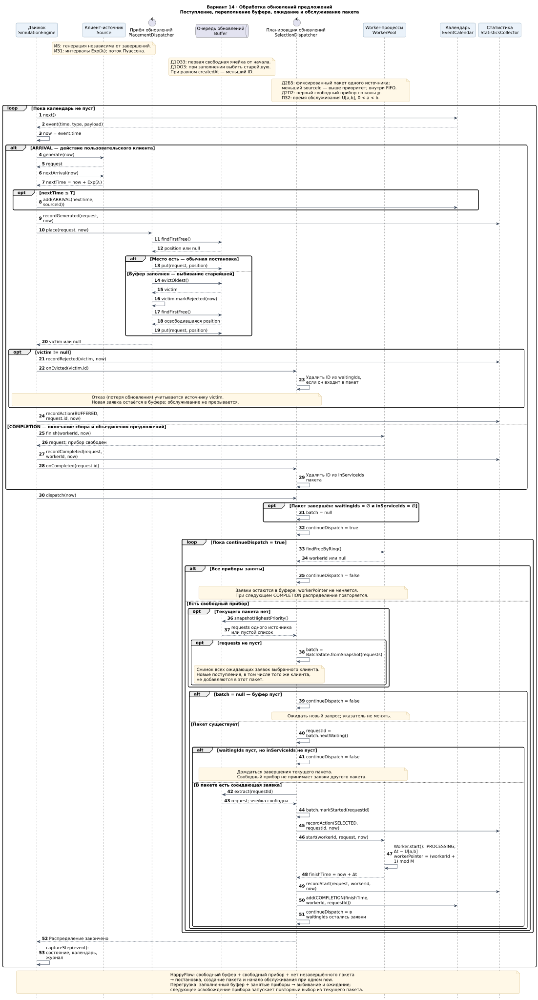
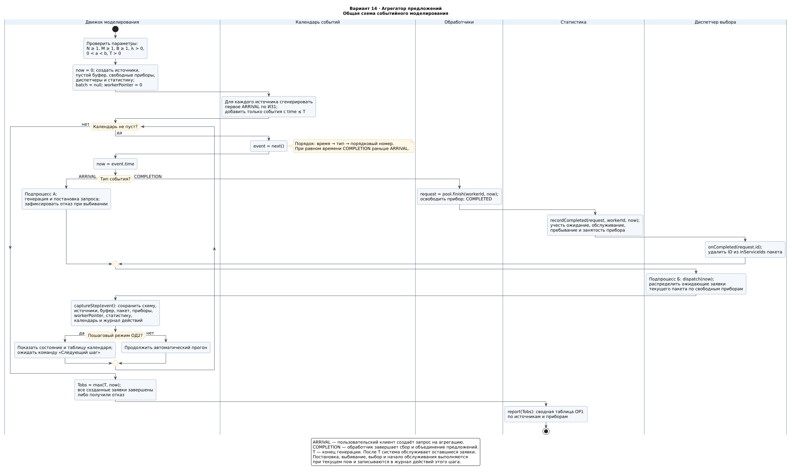
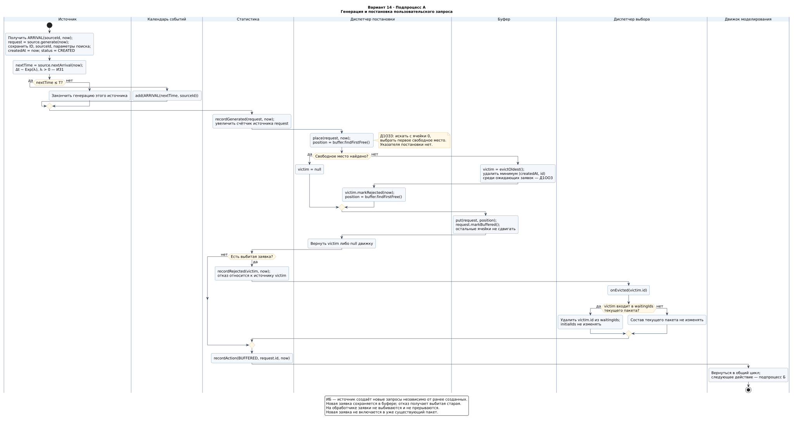
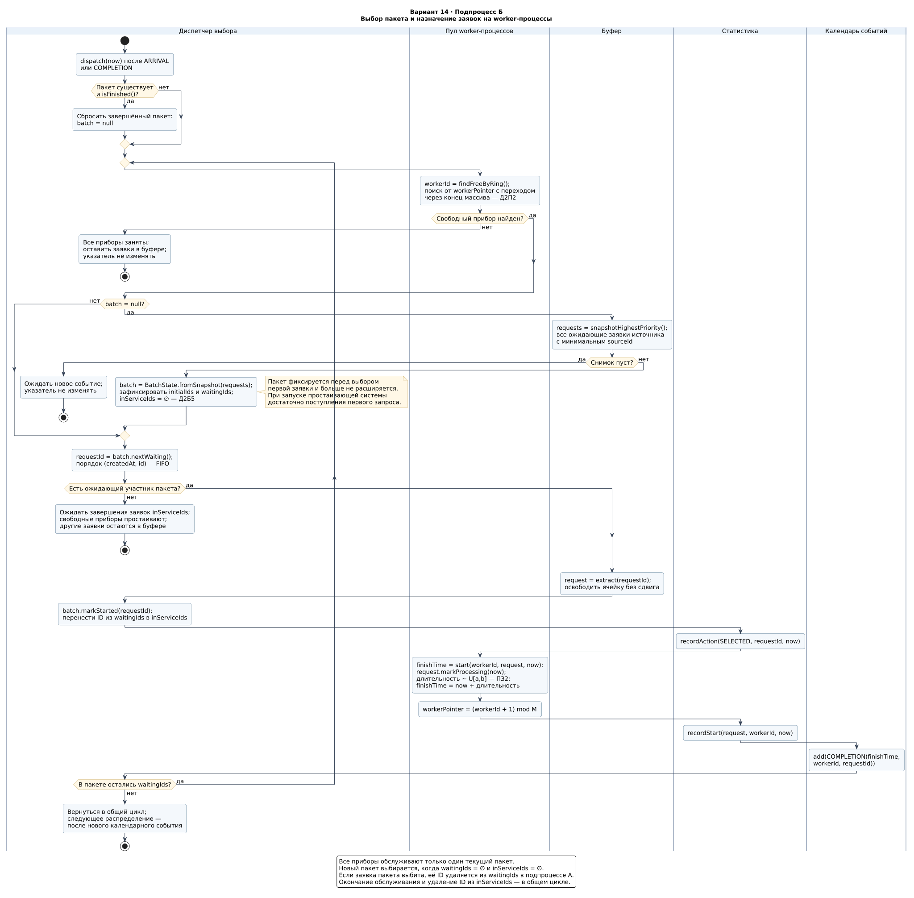

# Агрегатор предложений маркетплейсов — вариант 14

**Ивашин Даниил Владимирович**  
Группа **5130904/40102**

Пользователь ищет предложения, открывает каталог или меняет фильтры в веб-приложении либо Telegram-боте. Его действие создаёт запрос на актуальные цены и наличие. Обработчик обращается к API маркетплейсов, объединяет ответы и возвращает результат пользователю.

## Элементы модели

| Элемент СМО | Бизнес-сущность |
|---|---|
| Источник | Пользовательский клиент агрегатора |
| Заявка | Запрос на получение актуальных предложений |
| Буфер | Общая ограниченная очередь ожидающих запросов |
| Прибор | Обработчик, выполняющий агрегацию по запросу |
| Диспетчер постановки | Программный алгоритм размещения и выбивания заявок |
| Диспетчер выбора | Программный алгоритм формирования пакета и назначения обработчиков |
| Отказ | Выбивание старейшей ожидающей заявки при полном буфере |

## Формула варианта

**ИБ ИЗ1 ПЗ2 Д1ОЗ3 Д1ОО3 Д2П2 Д2Б5 ОР1 ОД2**

| Код | Правило модели |
|---|---|
| ИБ | Бесконечный источник: следующий запрос клиента не зависит от завершения предыдущих. |
| ИЗ1 | Пуассоновский поток запросов; интервалы поступления экспоненциальные с параметром λᵢ. |
| ПЗ2 | Время обслуживания равномерно распределено на [a, b], где 0 < a < b. |
| Д1ОЗ3 | Постановка в первую свободную ячейку от начала буфера. |
| Д1ОО3 | При полном буфере выбивается самая старая ожидающая заявка. |
| Д2П2 | Первый свободный прибор выбирается по кольцу от текущего указателя. |
| Д2Б5 | По приоритету номера источника выбирается фиксированный пакет всех его ожидающих заявок. |
| ОР1 | Сводная таблица результатов по источникам и приборам. |
| ОД2 | Схема и состояние системы после шага: источники, буфер, пакет, приборы, указатель, статистика и календарь. |

## Первичные артефакты

### 1. Общая диаграмма последовательности

Поступление запроса, постановка, переполнение, ожидание, выбор пакета, назначение и завершение обслуживания.



[Исходник PlantUML](docs/diagrams/sequence/main-flow.puml) · [PNG](docs/diagrams/sequence/main-flow.png)

### 2. Обычная обработка — Happy Flow

Пустой буфер, свободный обработчик и отсутствие незавершённого пакета: заявка сразу начинает обслуживание.


[Исходник PlantUML](docs/diagrams/sequence/happy-flow.puml) · [PNG](docs/diagrams/sequence/happy-flow.png)

### 3. Переполнение буфера

Все приборы заняты. Старейшая ожидающая заявка получает отказ; после освобождения прибора выбирается заявка текущего пакета.


[Исходник PlantUML](docs/diagrams/sequence/overflow.puml) · [PNG](docs/diagrams/sequence/overflow.png)

### 4. Пакетная обработка

Фиксация состава пакета, поступление новой заявки того же клиента, ожидание полного завершения и переход к следующему пакету.


[Исходник PlantUML](docs/diagrams/sequence/package-processing.puml) · [PNG](docs/diagrams/sequence/package-processing.png)

### 5. Диаграмма классов

Классы модели, приватные поля, методы и ссылки между взаимодействующими компонентами.


[Исходник PlantUML](docs/diagrams/class/class-diagram.puml) · [PNG](docs/diagrams/class/class-diagram.png)

### 6. Блок-схема с дорожками

Общий цикл событийного моделирования, обработка поступления и завершения, пошаговый режим и сбор статистики.



[Исходник PlantUML](docs/diagrams/flowchart/system-flow.puml) · [PNG](docs/diagrams/flowchart/system-flow.png)

### 7. Генерация и постановка запроса

Подпроцесс А: первое свободное место, выбивание старейшей заявки и обновление состава пакета.



[Исходник PlantUML](docs/diagrams/flowchart/arrival-placement.puml) · [PNG](docs/diagrams/flowchart/arrival-placement.png)

### 8. Выбор пакета и обслуживание

Подпроцесс Б: приоритет источника, фиксированный пакет, FIFO и кольцевой выбор обработчика.



[Исходник PlantUML](docs/diagrams/flowchart/batch-selection.puml) · [PNG](docs/diagrams/flowchart/batch-selection.png)

## Описание алгоритма

[Правила обработки, календарь событий, статистика и контрольный сценарий](docs/model.md).

Состав пакета фиксируется перед первым назначением и не расширяется. Следующий пакет выбирается после завершения всех оставшихся участников текущего. Выбитые заявки удаляются из ожидающей части пакета и учитываются как отказы. При простаивающей системе первый пакет создаётся после поступления заявки.

## Повторная отрисовка

Исходники находятся в `docs/diagrams/sequence`, `docs/diagrams/class` и `docs/diagrams/flowchart`; рядом сохранены SVG и PNG. Отрисовка проверена в PlantUML 1.2025.10 и Java 17. Для классов используется встроенный Smetana.

```bash
java -Djava.awt.headless=true -DPLANTUML_LIMIT_SIZE=20000 -jar plantuml.jar -charset UTF-8 -tsvg "docs/diagrams/**/*.puml"
java -Djava.awt.headless=true -DPLANTUML_LIMIT_SIZE=20000 -jar plantuml.jar -charset UTF-8 -tpng "docs/diagrams/**/*.puml"
```
